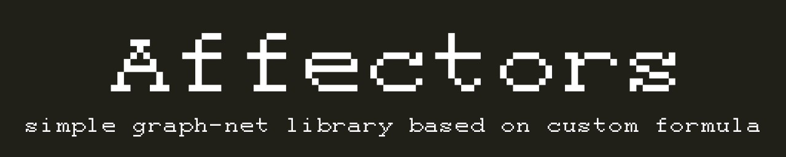

# affectors



Библиотека для расчёта и распространения «влияния» (affect) между блоками —
реализована на **numpy** (матричная версия) и чистом Python (классическая версия).

Устанавливается как обычный pip-пакет.

## Установка

### Из GitHub

```bash
pip install git+https://github.com/trust00err/affectors.git
```

### Для разработки (editable-режим)

```bash
git clone https://github.com/trust00err/affectors.git
cd affectors
pip install -e .
```

## Быстрый старт

### Классическая версия (без numpy)

```python
from affectors import AffectionBlockClassic, Transformations

transformations = Transformations()
block0 = AffectionBlockClassic(idx=0, base_affection=0.5, transformations=transformations)
block1 = AffectionBlockClassic(idx=1, input_blocks=[block0], base_affection=0.3, transformations=transformations)

print(block0.get_affection())  # само влияние
print(block0.out_sigmoid())   # влияние через сигмоиду
```

### Матричная версия (numpy + torch)

```python
from affectors import AffectionBlock

block = AffectionBlock(size=4, epsilon=1e-4, base_affection=1)

block.add_connection(0, 1)  # блок 0 → блок 1
block.add_connection(0, 2)  # блок 0 → блок 2
block.set_connections([(2, 3), (1, 3)])  # или список связей сразу

block.update_affection()

back_aff, dict_result = block.to_back_affect()   # распространение назад
front_aff, dict_result = block.to_front_affect() # распространение вперёд
probs = block.get_probs()                        # вероятности через softmax
```

## API

| Класс / метод | Описание |
|---|---|
| `Transformations` | функции активации: `sigmoid`, `relu`, `sigmoid_classic` |
| `AffectionBlockClassic` | блочная модель влияния (чистый Python) |
| `.to_back_affect()` | влияние «назад» по входящим блокам |
| `.to_front_affect()` | влияние «вперёд» по исходящим блокам |
| `.to_forgetting(step)` | забывание: экспоненциальное затухание base_affection |
| `AffectionBlock` | матричная версия на numpy/torch |
| `.add_connection(a, b)` | связь от блока `a` к блоку `b` |
| `.set_connections([...])` | установить список связей |
| `.update_affection()` | пересчитать влияния по матрице связей |
| `.get_probs()` | вероятности связей (softmax без self-связей) |

## Сборка wheel-файла (для передачи без GitHub)

```bash
pip install build
python -m build
# файл появится в dist/ — установить: pip install dist/affectors-0.1.0-py3-none-any.whl
```

## Лицензия

MIT — см. [LICENSE](LICENSE).
